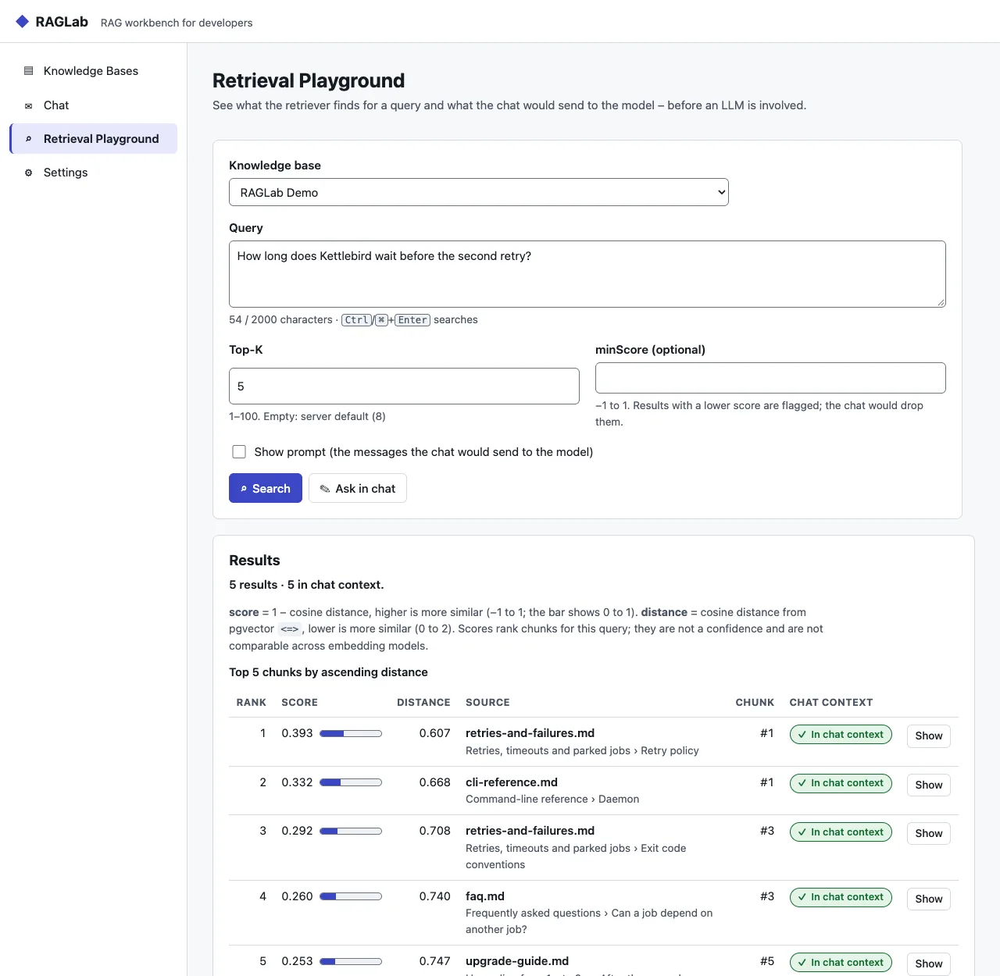
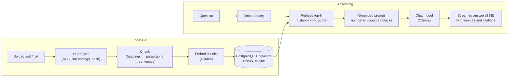
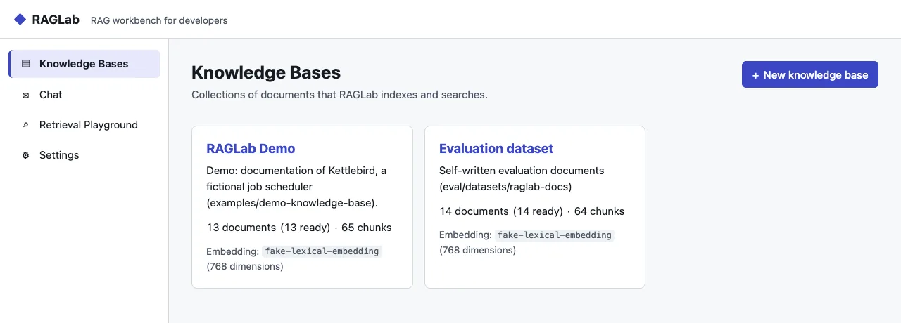
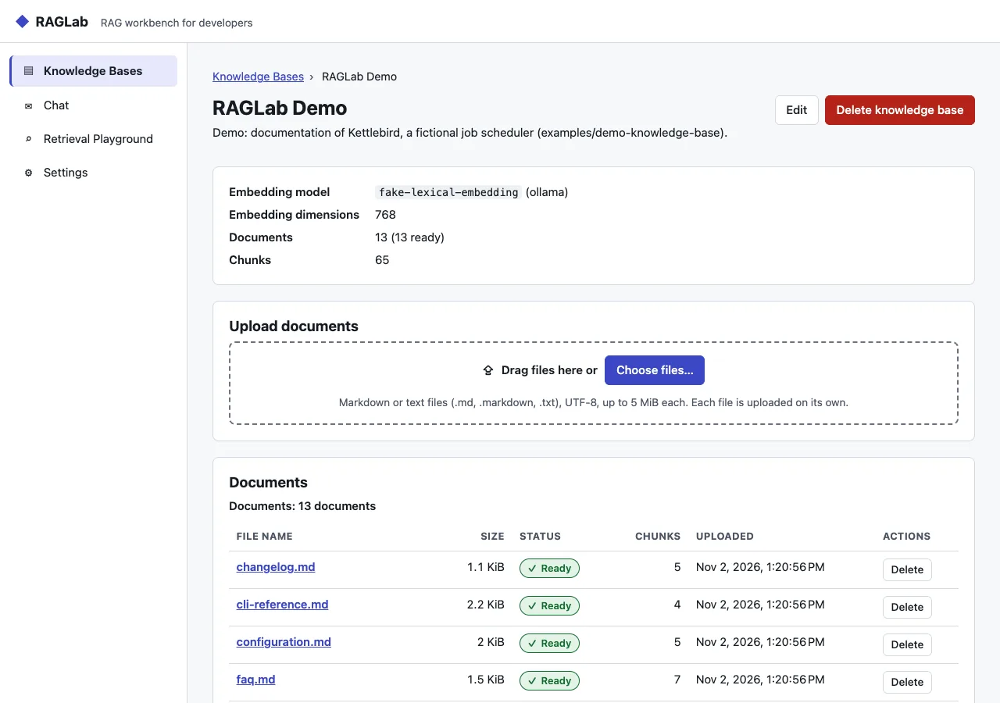
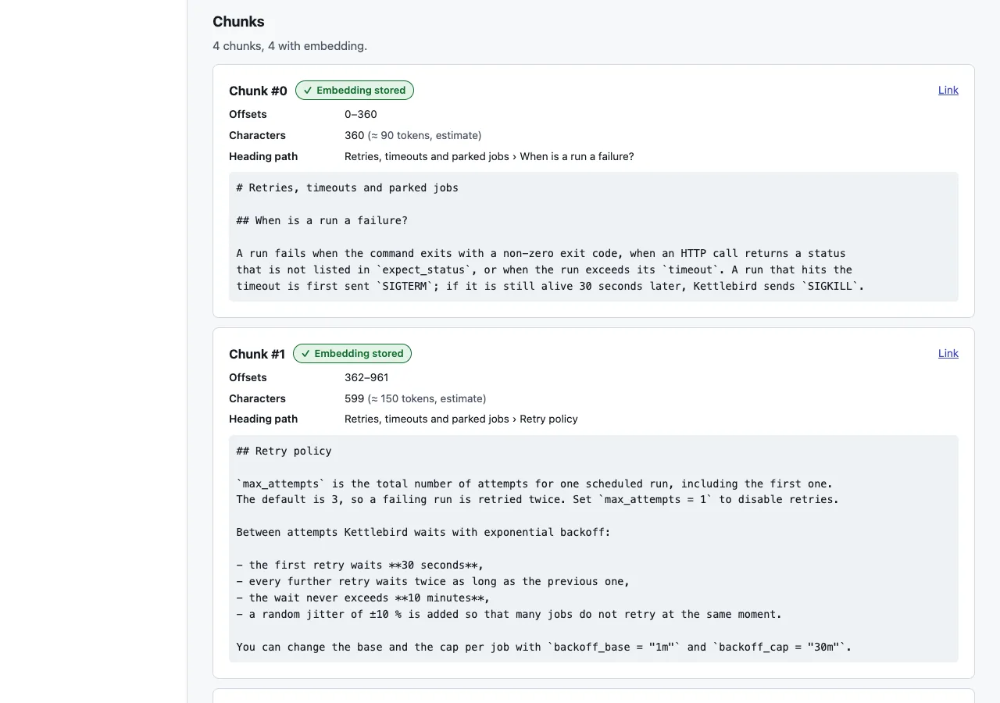
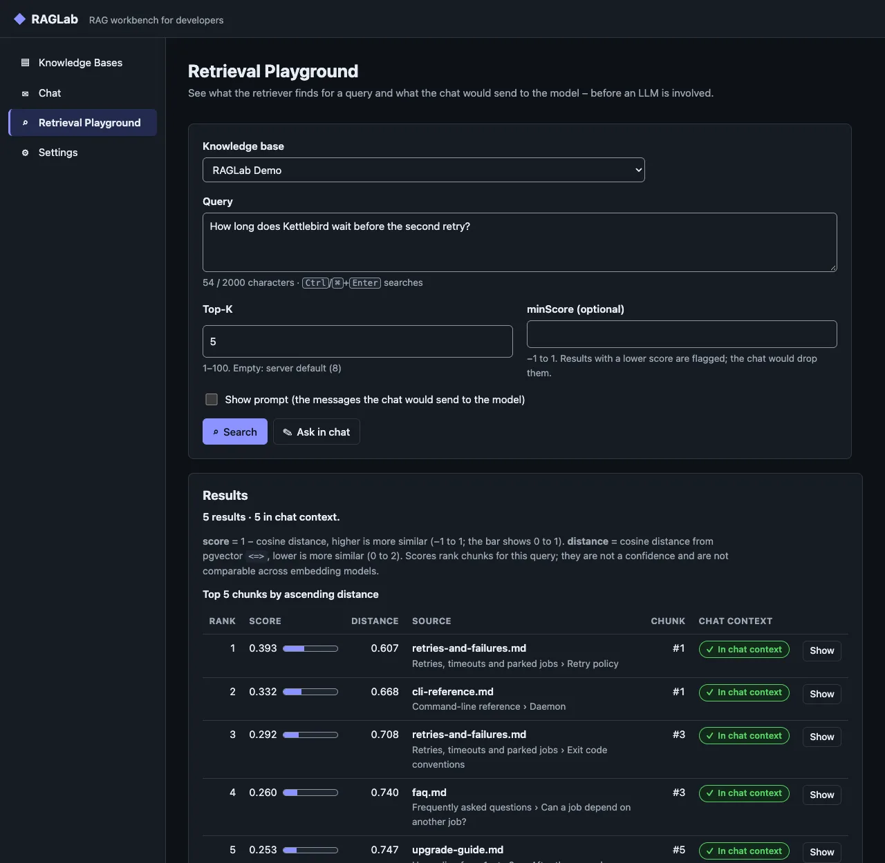
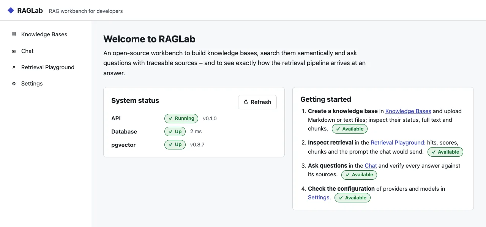
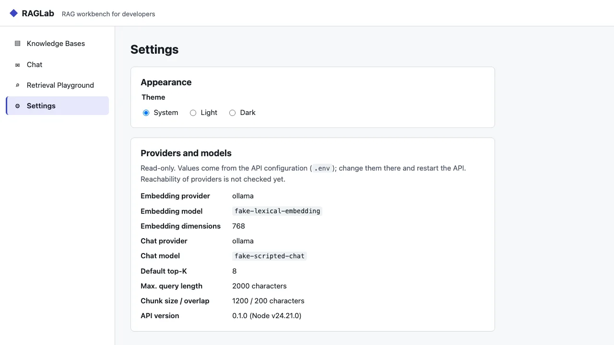

# RAGLab

[](https://github.com/krocon/rag-lab/actions/workflows/ci.yml)
[](LICENSE)

**A self-hosted, open-source RAG workbench for developers – not a ChatGPT clone.** RAGLab indexes
your Markdown and text files into PostgreSQL + pgvector and shows every step of the pipeline –
chunks, embeddings, retrieval scores, the exact prompt – so you can see _why_ an answer cites the
passages it cites.



<sub>All screenshots show the bundled [demo knowledge base](examples/demo-knowledge-base) and were
taken with **test providers instead of real models**: embeddings come from RAGLab's deterministic
lexical baseline (shown as `fake-lexical-embedding`, a hashed bag of words – scores reflect shared
words, not meaning), and the chat answer comes from a scripted fake model (`fake-scripted-chat`)
that says so in its first sentence. With real Ollama models the UI is the same; the numbers and
answers differ.</sub>

> **Status: v0.1.0, first public version.** Everything listed under [Features](#features) is
> implemented and covered by unit and integration tests. A full end-to-end run with real Ollama
> models was not possible in the development environment (no models installed); the pipeline was
> tested with fake providers. See [Limitations](#security--limitations) and
> [CHANGELOG.md](CHANGELOG.md).

## Contents

[Features](#features) · [How it works](#how-it-works) · [Quick start](#quick-start) ·
[Using the web app](#using-the-web-app) · [Configuration](#configuration) ·
[Retrieval transparency](#retrieval-transparency-distance-vs-score) · [API](#api) ·
[Evaluation](#evaluation) · [MCP server](#mcp-server) ·
[Security & limitations](#security--limitations) · [Project structure](#project-structure) ·
[Development](#development) · [Contributing](#contributing) · [License](#license)

## Features

**Knowledge bases and indexing**

- Collections ("knowledge bases") with Markdown/TXT upload: validation, text normalisation,
  duplicate detection by content hash, per-document status (`pending → processing → ready | failed`)
  with readable error messages, reindexing and deletion.
- Deterministic, heading-aware chunking with character offsets, heading path and overlap; chunk
  preview API.
- Embeddings via Ollama with batching, timeouts and dimension checks; vectors in PostgreSQL 18 +
  pgvector 0.8.7 with an HNSW index. The embedding model is recorded per collection.

**Retrieval and chat**

- Semantic search in one collection with top-K, `minScore`, cosine `distance` **and** `score`.
- Grounded chat: the best chunks go to the chat model as numbered, delimited sources; the answer
  streams via Server-Sent Events; citations like `[1]` are checked against the sources that were
  actually sent. If nothing matches, the model is not asked.
- Retrieval playground: what the chat would retrieve, which chunks fit into the context budget,
  diagnostics (models, index state, HNSW settings, timings) and the exact prompt – without calling
  the chat model.

**Web app (Angular 22)**

- Knowledge-base management with drag-and-drop upload, live status, full text and chunk view.
- Chat with source cards, clickable citations and links to the exact chunk.
- Retrieval playground with shareable URLs; read-only settings; light and dark theme.

**Integration and operations**

- MCP server (stdio) with four read-only tools for Claude Desktop, Claude Code and other MCP
  clients.
- Retrieval evaluation (Recall@K, Precision@K, Hit-Rate@K, MRR) on a bundled, self-written dataset.
- Hardening: strict validation, security headers, CORS/Origin/Host checks, rate limits, upload
  limits, log redaction (no authentication – see below).
- Non-root Docker images, one-command Docker Compose stack, CI, release workflow, OpenAPI docs.
- Demo dataset with a one-command seed (`pnpm demo:seed`).

**Not implemented (planned or ideas)** – not part of the current version:

- Hybrid search (keyword + vector) and reranking.
- Chat history: each question is answered on its own; nothing is stored on the server.
- Further formats (PDF, HTML, DOCX); only `.md`, `.markdown` and `.txt` are supported.
- Other providers, e.g. an OpenAI-compatible embedding adapter – only Ollama exists today.
- Re-chunking of fully indexed documents after changing `CHUNK_SIZE`/`CHUNK_OVERLAP`.
- Markdown rendering of answers (they are shown as plain text on purpose).
- Authentication and multiple users; MCP over HTTP and write tools.

## How it works



The web app talks to the API over REST and SSE; the MCP server talks to the same API over HTTP:

```text
apps/web (Angular 22) ──REST/SSE──▶ apps/api (Fastify 5) ──SQL──▶ PostgreSQL 18 + pgvector
                                          └──HTTP──▶ Ollama (embeddings, chat)
MCP clients ──stdio──▶ apps/mcp (Node) ──HTTP──▶ apps/api
```

Design and decisions (German): [architecture](docs/architecture.md),
[data model](docs/data-model.md), [ADRs](docs/adr/) (technology stack, RAG pipeline, MCP server).

## Quick start

You need **Docker** with Compose and **[Ollama](https://ollama.com)** running natively (on macOS
containers have no GPU access). For the development variant also **Node.js ≥ 24.15** (26 LTS
recommended) and **pnpm** (any version ≥ 10; the version pinned in `package.json` is used).

### 1. Install the models (your step)

RAGLab **never downloads models for you**. Pull the models named in `.env.example` (or change
`EMBEDDING_MODEL`/`CHAT_MODEL` to models you already have):

```bash
ollama pull nomic-embed-text      # EMBEDDING_MODEL, 768 dimensions
ollama pull llama3.2              # CHAT_MODEL (example; any Ollama chat model works)
ollama list                       # shows the installed models
```

`EMBEDDING_DIMENSIONS` must match the embedding model (768 for `nomic-embed-text`) and the database
column `vector(768)`; another dimension needs a migration ([data model](docs/data-model.md#embedding-dimension)).

### 2a. Run everything in containers

```bash
git clone https://github.com/krocon/rag-lab.git
cd rag-lab
cp .env.example .env                          # change POSTGRES_PASSWORD (and DATABASE_URL); never commit .env
docker compose --profile app up -d --build    # postgres → migrate → api → web
docker compose ps                             # all healthy, migrate "exited (0)"
```

Open <http://localhost:8080>. nginx serves the web app and proxies `/api` (including the streamed
chat) to the API container, which reaches your native Ollama via `host.docker.internal`
(`OLLAMA_DOCKER_BASE_URL`). All containers run as non-root users with read-only root file systems;
every port is published on `127.0.0.1` only.

### 2b. Or run it for development

```bash
git clone https://github.com/krocon/rag-lab.git
cd rag-lab
cp .env.example .env        # adjust if needed – never commit .env
pnpm install
pnpm db:up                  # PostgreSQL + pgvector on 127.0.0.1:5432
pnpm db:migrate             # applies SQL migrations
pnpm dev                    # API on :3000, web app on :4200
```

Open <http://localhost:4200>; API docs (OpenAPI) are at <http://localhost:3000/api/docs>. If port
5432 is taken, change `POSTGRES_PORT` **and** the port in `DATABASE_URL`.

### 3. Load the demo and ask the first question

```bash
pnpm demo:seed     # both variants: the API listens on 127.0.0.1:3000
```

The script only needs Node.js – without `pnpm install` run `node scripts/demo-seed.mjs` instead.

`pnpm demo:seed` creates the knowledge base **RAGLab Demo** through the REST API, uploads the
[demo dataset](examples/demo-knowledge-base) (documentation of _Kettlebird_, a fictional job
scheduler), waits until every document is indexed and prints the status. It is idempotent: running
it again reuses the collection and uploads only what is missing; `--reset` rebuilds it. If the API
or Ollama is not reachable, or the embedding model is missing, it says so and exits with code 1.

Then open **Chat**, pick _RAGLab Demo_ and ask, for example, _"How long does Kettlebird wait before
the second retry?"_. The sources appear first, then the answer streams in with citations like
**[1]** that link to the cited passage. More questions with expected answers:
[examples/demo-knowledge-base/README.md](examples/demo-knowledge-base/README.md).

Prefer your own files? **Knowledge Bases → New knowledge base**, then drop Markdown or text files
on the upload area.

### Check the AI provider

```bash
curl -s localhost:3000/api/system/providers               # reachable? model installed? dimensions
curl -s 'localhost:3000/api/system/providers?verify=true' # also embeds one test text (costs compute)
```

The response reports `reachable` and `modelAvailable` for the embedding and the chat model, and
`dimensions: { configured, column, verified? }` for embeddings. An unreachable provider does
**not** make `/api/health/ready` fail – the UI stays usable, and documents fail with a clear
message until the provider is back. With the container stack use port 8080 instead of 3000.

| Document error / provider status                  | Fix                                                                                                 |
| ------------------------------------------------- | --------------------------------------------------------------------------------------------------- |
| `Embedding model "…" is not installed in Ollama.` | `ollama pull <EMBEDDING_MODEL>`, then reindex the document (or run `pnpm demo:seed` again)          |
| `Ollama is not reachable.`                        | Start Ollama (`ollama serve` or the app), check `OLLAMA_BASE_URL` / `OLLAMA_DOCKER_BASE_URL`        |
| `Ollama did not answer within … ms.`              | The first request loads the model – reindex, or raise `EMBEDDING_TIMEOUT_MS`                        |
| `… returned vectors with N dimensions …`          | `EMBEDDING_DIMENSIONS` does not match the model (and the `vector(768)` column)                      |
| `EMBEDDING_MODEL_MISMATCH: …`                     | The collection was created with another model; restore the configuration or create a new collection |
| Readiness `schema` down                           | `EMBEDDING_DIMENSIONS` ≠ database column; see [data model](docs/data-model.md#embedding-dimension)  |

On Linux you can run Ollama in a container instead: `docker compose --profile ollama up -d` (set
`OLLAMA_DOCKER_BASE_URL=http://ollama:11434` for the app profile). An optional live test against
your Ollama: `RAGLAB_LIVE_TESTS=1 pnpm --filter @raglab/api test:live`.

### Operating the container stack

- **Upgrade:** back up first (`docker compose exec postgres pg_dump -U raglab raglab > backup.sql`),
  then `git pull` and `docker compose --profile app up -d --build` – new migrations run
  automatically in the one-shot `migrate` service.
- **Released images** (GitHub Container Registry, available after the first release): set
  `RAGLAB_API_IMAGE=ghcr.io/<owner>/raglab-api:<version>` and `RAGLAB_WEB_IMAGE=…/raglab-web:<version>`
  in `.env` and run `docker compose --profile app up -d --no-build`.
- **Smoke test:** `pnpm docker:smoke` builds the images and checks the whole stack with a fake
  Ollama (upload → chat through nginx) and removes the app containers afterwards.

Images, health checks, limits, CI and the release checklist: [docs/release.md](docs/release.md)
(German).

## Using the web app

| Knowledge bases                                                                                                                                                                                          | Collection detail                                                                                                                                                                                                                              |
| -------------------------------------------------------------------------------------------------------------------------------------------------------------------------------------------------------- | ---------------------------------------------------------------------------------------------------------------------------------------------------------------------------------------------------------------------------------------------- |
|  |                          |
| **Chunks of a document**                                                                                                                                                                                 | **Chat with sources** (scripted fake model)                                                                                                                                                                                                    |
|                                      | ![Chat in dark mode: the question, an answer that starts with "Scripted answer from a fake test model – not real LLM output" and cites [1], and the selected source card with section, score and distance](docs/images/chat-sources-dark.webp) |
| **Retrieval playground** (dark)                                                                                                                                                                          | **Welcome and settings**                                                                                                                                                                                                                       |
|                              |    |

1. **Knowledge Bases → New knowledge base**: name (unique) and optional description. The embedding
   model configured on the server is recorded with it.
2. On the knowledge base page, **choose files** or drag and drop Markdown/text files. Files are
   checked against the server limits first and uploaded one by one with progress; errors (wrong
   type, too large, duplicate content with a link to the existing document) are shown per file.
3. The document table shows each document's status – `Pending`, `Processing`, `Ready` or `Failed`
   with the error message – and refreshes while documents are processed. Use **Reindex** on failed
   documents after fixing the cause.
4. Open a document to see its metadata, the normalized full text and its chunks (index, offsets,
   heading path, characters, whether an embedding is stored). Links of the form
   `/knowledge-bases/<collection-id>/documents/<document-id>?chunk=<chunk-id>` highlight a chunk.
5. **Chat**: pick a knowledge base with at least one `Ready` document (`/chat?collection=<id>`
   preselects one), type a question, press **Enter** (**Shift+Enter** adds a line). Sources appear
   first, then the answer streams in. Citations like **[1]** highlight the matching source card
   (file, section, `score`, excerpt, link to the chunk); numbers the model was not given are marked
   **unknown source** and never linked. **Cancel answer** (or **Esc**) stops generation and keeps
   the partial text; errors say where they happened and offer **Try again**. The conversation lives
   only in the browser tab; **New chat** clears it.
6. **Retrieval Playground**: choose a knowledge base, enter a query, optionally set **Top-K** and
   **minScore**, and tick **Show prompt** to see the exact messages the chat would send. The state
   is kept in the URL (`/playground?collection=<id>&q=<query>&topK=5&minScore=0.3&prompt=1`). Each
   hit shows rank, score, distance, file, section and whether it is **In chat context**, **Outside
   budget** or **Below minScore**; **Diagnostics** show models, index state, search settings,
   budget, timings and warnings. **Ask in chat** opens the chat with the same question.
7. **Settings** shows the configured providers and pipeline defaults (read-only) and the theme
   (system, light, dark).

## Configuration

All settings are environment variables, validated at startup. [.env.example](.env.example)
documents every option with a safe example value; copy it to `.env` (git-ignored). The most
important ones:

| Variable                                  | Example (`.env.example`)                       | Meaning                                                                 |
| ----------------------------------------- | ---------------------------------------------- | ----------------------------------------------------------------------- |
| `POSTGRES_PASSWORD`, `DATABASE_URL`       | `raglab-local-dev-only`, `postgresql://…`      | Database credentials (change them; keep both in sync)                   |
| `OLLAMA_BASE_URL`                         | `http://localhost:11434`                       | Ollama for the API started with `pnpm dev`                              |
| `OLLAMA_DOCKER_BASE_URL`                  | `http://host.docker.internal:11434`            | Ollama as seen from the API container                                   |
| `EMBEDDING_MODEL`, `EMBEDDING_DIMENSIONS` | `nomic-embed-text`, `768`                      | Embedding model and its dimension (must match the `vector(768)` column) |
| `CHAT_MODEL`                              | `llama3.2`                                     | Chat model for answers                                                  |
| `CHUNK_SIZE`, `CHUNK_OVERLAP`             | `1200`, `200`                                  | Chunk size and overlap in characters (new documents only)               |
| `RETRIEVAL_TOP_K`                         | `8`                                            | Chunks per search when the request sets no `topK`                       |
| `CHAT_CONTEXT_CHAR_BUDGET`                | `12000`                                        | Characters of sources sent to the chat model                            |
| `MAX_UPLOAD_BYTES`, `MAX_UPLOAD_FILES`    | `5242880`, `20`                                | Upload limits per file and per request                                  |
| `CORS_ORIGINS`, `ALLOWED_HOSTS`           | `http://localhost:4200`, `localhost,…`         | Browser origins and host names the API accepts                          |
| `NETWORK_ACCESS_PROTECTED`                | `false`                                        | Set `true` only behind an authenticating reverse proxy                  |
| `RATE_LIMIT_*`, `MAX_CONCURRENT_CHATS`    | `300`/min, upload `30`, chat `20`, search `60` | Rate limits per client IP (`429 RATE_LIMITED`)                          |
| `API_DOCS_ENABLED`                        | `true`                                         | Serve OpenAPI docs at `/api/docs`                                       |
| `RAGLAB_API_URL`                          | `http://127.0.0.1:3000`                        | API URL for the MCP server (`pnpm demo:seed` reads it from the shell)   |

## Retrieval transparency: distance vs. score

Every search result carries **both** values of the same metric, clearly named:

- **`distance`** – pgvector's cosine distance (`<=>`), `0..2`, **lower** is more similar;
- **`score`** – `1 − distance` (cosine similarity), `−1..1`, **higher** is more similar.

Results are ordered by ascending distance. A score ranks chunks **for one query and one embedding
model** – it is not a confidence, there is no universal "good" threshold, and scores of different
models cannot be compared. Use the playground to choose a sensible `minScore` for your documents.
The chat shows the same `score` on its source cards, and the playground tells you which chunks
actually fit into the chat context.

## API

All endpoints live under `/api`; the OpenAPI description is served at `/api/docs` (UI) and
`/api/docs/json`.

| Method   | Path                             | Purpose                                                            |
| -------- | -------------------------------- | ------------------------------------------------------------------ |
| `GET`    | `/api/health`                    | Liveness                                                           |
| `GET`    | `/api/health/ready`              | Readiness: database, pgvector, embedding column dimension          |
| `GET`    | `/api/system/info`               | Configured providers and pipeline defaults                         |
| `GET`    | `/api/system/providers`          | Live provider status (`?verify=true` adds a test embedding)        |
| `GET`    | `/api/collections`               | List collections with document and chunk counts                    |
| `POST`   | `/api/collections`               | Create a collection `{ name, description? }`                       |
| `GET`    | `/api/collections/:id`           | Get a collection                                                   |
| `PATCH`  | `/api/collections/:id`           | Rename or change the description                                   |
| `DELETE` | `/api/collections/:id`           | Delete a collection with all its documents and chunks              |
| `POST`   | `/api/collections/:id/documents` | Upload Markdown/text files (multipart) → `202 Accepted`            |
| `GET`    | `/api/collections/:id/documents` | List document metadata                                             |
| `GET`    | `/api/documents/:id`             | Document metadata including status, error message and chunk count  |
| `GET`    | `/api/documents/:id/content`     | Normalised text of a document                                      |
| `GET`    | `/api/documents/:id/chunks`      | Chunks of a document with offsets and heading path (no vectors)    |
| `POST`   | `/api/documents/:id/reindex`     | Process a `failed` document (or one missing embeddings) again      |
| `DELETE` | `/api/documents/:id`             | Delete a document with its chunks                                  |
| `POST`   | `/api/chunking/preview`          | Chunk a text without storing it `{ text, format, targetSize? }`    |
| `POST`   | `/api/retrieval/search`          | Semantic search in one collection `{ collectionId, query, topK? }` |
| `POST`   | `/api/chat`                      | Grounded answer, streamed as SSE `{ collectionId, question }`      |
| `POST`   | `/api/playground/search`         | Retrieval diagnostics: hits, chat context, stats, optional prompt  |

A collection records the embedding provider, model and dimensions configured when it was created;
they cannot be changed afterwards. Collection names are unique, case-insensitively. Every error has
the same shape – `code` is machine-readable (`VALIDATION_ERROR`, `COLLECTION_NOT_FOUND`,
`RATE_LIMITED`, …), `details` is optional:

```json
{
  "error": {
    "code": "COLLECTION_NAME_TAKEN",
    "message": "A collection named \"docs\" already exists"
  }
}
```

Unknown body fields and query parameters are rejected with `400`; requests are rate limited (`429`
with `Retry-After`); browsers may only call the API from origins in `CORS_ORIGINS`.

### Uploading documents

```bash
curl -s -X POST localhost:3000/api/collections \
  -H 'content-type: application/json' -d '{"name":"Docs","description":"Project docs"}'
curl -s -F "file=@README.md" -F "file=@docs/notes.txt" \
  http://localhost:3000/api/collections/<collection-id>/documents
```

- Allowed: `.md`, `.markdown`, `.txt`, UTF-8 encoded; the type comes from the extension. Limits:
  `MAX_UPLOAD_BYTES` per file (default 5 MiB), `MAX_UPLOAD_FILES` per request (default 20).
- Text is normalised before it is stored (BOM removed, line endings → `\n`, Unicode NFC, control
  characters removed, more than two blank lines collapsed). The same normalised content can exist
  only once per collection (`409 DUPLICATE_DOCUMENT` with `details.existingDocumentId`).
- All files of a request are validated first; one invalid file rejects the whole request.
- The response is `202 Accepted` with every document `pending`. Poll `GET /api/documents/:id` for
  `pending → processing → ready | failed`; `ready` means **chunked and embedded**.
- If the provider fails (not running, model missing, timeout, wrong dimension), the document becomes
  `failed` with a readable `errorMessage`. Fix the cause and
  `curl -s -X POST localhost:3000/api/documents/<document-id>/reindex` (`202`; `409 DOCUMENT_BUSY`
  while processing, `409 DOCUMENT_ALREADY_INDEXED` if every chunk has an embedding). A document
  that was `processing` during a restart becomes `failed` with a hint; reindex it.

| Status | Code                                              | Meaning                                            |
| ------ | ------------------------------------------------- | -------------------------------------------------- |
| `400`  | `NO_FILE`, `EMPTY_DOCUMENT`, `INVALID_ENCODING`   | No file, blank file, not UTF-8 / binary            |
| `400`  | `MALFORMED_MULTIPART`, `VALIDATION_ERROR`         | Broken multipart body, malformed id                |
| `404`  | `COLLECTION_NOT_FOUND`                            | Unknown collection                                 |
| `409`  | `DUPLICATE_DOCUMENT`                              | Same content exists (`details.existingDocumentId`) |
| `413`  | `FILE_TOO_LARGE`, `TOO_MANY_FILES`                | Limits exceeded                                    |
| `415`  | `UNSUPPORTED_FILE_TYPE`, `UNSUPPORTED_MEDIA_TYPE` | Extension not allowed, not multipart               |

### Chunking

Documents are split deterministically into chunks of at most `CHUNK_SIZE` characters (default 1200) with up to `CHUNK_OVERLAP` characters (default 200) repeated from the previous chunk.
Markdown is split at headings first, then at paragraphs, sentences, lines and words; a word is
only cut when it is longer than `CHUNK_SIZE`. Every chunk carries `startOffset`/`endOffset` into
the normalised text and its heading path, e.g. `["Installation", "Docker"]` – rules and limits in
[ADR 0002](docs/adr/0002-rag-pipeline.md#2-chunking-deterministisch). Changed sizes apply to newly
processed documents only.

```bash
curl -s localhost:3000/api/chunking/preview -H 'content-type: application/json' \
  -d '{"text":"# Title\n\nSome text.","format":"markdown","targetSize":200,"overlap":40}'
```

### Searching

```bash
curl -s -X POST localhost:3000/api/retrieval/search -H 'content-type: application/json' \
  -d '{"collectionId":"<collection-id>","query":"How do I reindex a document?","topK":5}'
```

The query is embedded with the configured provider and compared with the chunks of **one**
collection (only `ready` documents). Results have a gapless `rank`, `distance`, `score`, document
id, filename, chunk index, heading path, offsets and text, plus the embedding model and `timings`.
Optional: `topK` (1–100, default `RETRIEVAL_TOP_K`) and `minScore` (−1..1). The query may have at
most `MAX_QUERY_CHARS` characters (default 2000). An empty result is `200` with `results: []` and
`emptyReason` (`collection_empty`, `no_indexed_chunks`, `below_min_score`).

| Status | Code                             | Meaning                                                        |
| ------ | -------------------------------- | -------------------------------------------------------------- |
| `400`  | `VALIDATION_ERROR`               | Blank or too long query, `topK`/`minScore` out of range        |
| `404`  | `COLLECTION_NOT_FOUND`           | Unknown collection                                             |
| `409`  | `EMBEDDING_MODEL_MISMATCH`       | The collection was embedded with another model than configured |
| `502`  | `EMBEDDING_PROVIDER_ERROR`       | Provider answered with an error (e.g. model not installed)     |
| `503`  | `EMBEDDING_PROVIDER_UNAVAILABLE` | Provider not reachable or timed out – retry later              |

`POST /api/playground/search` (same body plus `includePrompt`) runs exactly the retrieval and prompt
building of the chat without calling the chat model and adds `includedInChatContext`,
`belowMinScore`, `stats`, `embedding`, `search`, `chatContext`, `warnings`, `timings` and – with
`includePrompt: true` – `prompt.messages`.

### Asking questions (chat)

```bash
curl -N -X POST localhost:3000/api/chat -H 'content-type: application/json' \
  -d '{"collectionId":"<collection-id>","question":"How do I reindex a document?"}'
```

The question is used as the search query; the best chunks are sent to `CHAT_MODEL` as numbered
sources, and the response is a stream of
[Server-Sent Events](https://html.spec.whatwg.org/multipage/server-sent-events.html):

```text
event: sources
data: {"sources":[{"n":1,"documentId":"…","chunkId":"…","chunkIndex":3,"filename":"guide.md","headingPath":["Reindexing"],"content":"…","score":0.82,"distance":0.18}]}

event: token
data: {"text":"Send POST /api/documents/:id/reindex "}

event: token
data: {"text":"for a failed document [1]."}

event: done
data: {"answerStatus":"answered","citedSources":[1],"unknownCitations":[],"model":"llama3.2","timings":{"embeddingMs":21.4,"searchMs":3.1,"firstTokenMs":412.7,"generationMs":1830.2,"totalMs":1856.9}}
```

(An illustration of the format; the values are made up.)

- `sources` always comes first; `[n]` in the answer refers to source `n`. Citations without a
  delivered source are listed in `done.unknownCitations` and must not be linked.
- Sources are added in rank order until `CHAT_CONTEXT_CHAR_BUDGET` is used up; sources that do not
  fit are neither sent nor listed.
- If nothing matches, the model is **not** called: `sources` is empty, one fixed `token` says so,
  and `done` has `answerStatus: "no_sources"`.
- Errors before the stream starts are normal JSON errors (as for searching, plus `400` for a blank
  or too long question). Chat model failures during the stream arrive as `event: error` with
  `{ code, message }` (`CHAT_PROVIDER_UNAVAILABLE`, `CHAT_PROVIDER_ERROR`), and the stream ends.
- Closing the connection cancels the request to the model. No chat history is stored or sent.

## Evaluation

`pnpm eval` measures retrieval quality: it indexes the bundled, self-written dataset
([eval/datasets/raglab-docs](eval/datasets/raglab-docs), 14 documents, 40 questions with relevance
anchors) into a temporary collection through the real services, runs every question through the
retrieval service and prints Recall@K, Precision@K, Hit-Rate@K and MRR for K = 1, 3, 5, 10 at
document and section level. Results (with model, chunk settings and commit) are written to
`eval/results/` (git-ignored) so runs can be compared.

```bash
pnpm eval              # configured embedding model – needs Ollama with EMBEDDING_MODEL installed
pnpm eval --baseline   # deterministic lexical baseline, no Ollama (also runs in CI)
pnpm eval --injection  # optional live prompt-injection check with CHAT_MODEL (report only)
```

Only the lexical baseline has been measured so far – it checks the wiring, not the quality of a
real model; a reference run with a real embedding model is still open. Dataset format:
[eval/README.md](eval/README.md); metrics and runs: [docs/evaluation.md](docs/evaluation.md)
(German).

## MCP server

`apps/mcp` lets MCP clients such as Claude Desktop or Claude Code use your knowledge bases. It runs
locally over stdio, talks only to the RAGLab API and offers four **read-only** tools:

| Tool               | What it does                                                                                  |
| ------------------ | --------------------------------------------------------------------------------------------- |
| `list_collections` | Lists collections with ID, name, description, document/chunk counts and embedding model       |
| `search_knowledge` | Semantic search in a collection (ID or name): rank, score, distance, file, heading path, text |
| `get_document`     | Metadata and text of a document, or one chunk with surrounding context (`maxChars` limit)     |
| `ask_knowledge`    | Grounded answer from RAGLab's chat with sources, citations and `answerStatus`                 |

Start the API, build the server with `pnpm build:mcp`, then register `node` with the **absolute**
path to `apps/mcp/dist/main.js` (use `node` directly, not `pnpm start` – stdout belongs to the
protocol):

```bash
claude mcp add raglab -- node /abs/path/to/rag-lab/apps/mcp/dist/main.js   # Claude Code
```

Claude Desktop (`claude_desktop_config.json`, Settings → Developer → Edit Config):

```json
{
  "mcpServers": {
    "raglab": {
      "command": "node",
      "args": ["/abs/path/to/rag-lab/apps/mcp/dist/main.js"],
      "env": { "RAGLAB_API_URL": "http://127.0.0.1:3000" }
    }
  }
}
```

With the container stack, the MCP server can run as a container on the private compose network:
register `docker` with the arguments
`compose -f /abs/path/to/rag-lab/docker-compose.yml --profile mcp run --rm -T mcp`. Settings
(`RAGLAB_API_URL`, `MCP_MAX_OUTPUT_CHARS`, `MCP_REQUEST_TIMEOUT_MS`, `MCP_CHAT_TIMEOUT_MS`) are in
[.env.example](.env.example). Tool results mark document content as **untrusted**; keep tool-call
confirmations enabled in your client. Details: [apps/mcp/README.md](apps/mcp/README.md),
[ADR 0003](docs/adr/0003-mcp-server.md) (German).

## Security & limitations

> **RAGLab has no authentication.** Run it on `127.0.0.1` (the default) and **never expose it to a
> network or the internet without a reverse proxy that enforces authentication** (TLS + login, e.g.
> nginx/Caddy with basic auth or oauth2-proxy). Then set `ALLOWED_HOSTS`, `CORS_ORIGINS` and
> `NETWORK_ACCESS_PROTECTED=true`; the API warns at startup if it listens on a non-local address
> without it.

- **Prompt injection is a residual risk.** Documents are untrusted. They are sent to the model as
  delimited `<source>` blocks with neutralised delimiters, the system prompt tells the model to
  ignore instructions inside them, and the model has no tools. This **lowers the risk but cannot
  prevent** a manipulated document from steering an answer – always check answers against the
  cited sources. The demo dataset contains a clearly marked
  [injection example](examples/demo-knowledge-base/prompt-injection-demo.md) to try this out.
- Built-in hardening: strict request validation, security headers (CSP), CORS allowlist, Origin and
  Host checks against CSRF and DNS rebinding, rate limits, a limit on concurrent chats, upload
  limits and binary detection, credential redaction in logs. The MCP server only offers read-only
  tools and marks document content as untrusted.
- Answers are only as good as retrieval and the chat model: a score is not a confidence, and a
  fluent answer can still be wrong. Only `.md`/`.txt` are supported, there is no chat history, and
  answers are shown as plain text.
- Verified in development with fake providers only – see the status note at the top.

Threat model and residual risks: [docs/security.md](docs/security.md) (German). Reporting
vulnerabilities: [SECURITY.md](SECURITY.md).

## Project structure

```text
apps/api/                    Fastify API (TypeScript, Drizzle ORM, SQL migrations in apps/api/drizzle)
apps/web/                    Angular app (standalone components, signals, zoneless)
apps/mcp/                    MCP server (stdio) for external AI clients, talks to the API over HTTP
packages/shared/             Type-only API contracts shared by api, web and mcp
examples/demo-knowledge-base/ Self-written demo dataset (fictional "Kettlebird" docs) for pnpm demo:seed
eval/                        Evaluation dataset and (git-ignored) results
infra/docker/                Dockerfiles and nginx config
scripts/                     Demo seed, Docker smoke test, release versioning, link check
docs/                        Architecture, data model, ADRs, security, evaluation, release (German),
                             screenshots (docs/images), demo video script (docs/demo)
prompts/                     Numbered work prompts that drove the development (German)
```

## Development

| Command                                           | What it does                                         |
| ------------------------------------------------- | ---------------------------------------------------- |
| `pnpm dev`                                        | API (watch mode) and web dev server in parallel      |
| `pnpm test`                                       | Unit tests (API, web, MCP server and scripts)        |
| `pnpm test:integration`                           | API integration tests – needs `pnpm db:up`¹          |
| `pnpm eval` / `pnpm eval --baseline`              | Retrieval evaluation (see [Evaluation](#evaluation)) |
| `pnpm demo:seed [--reset]`                        | Load the demo knowledge base through the API         |
| `pnpm docs:links`                                 | Check relative links in the Markdown documentation   |
| `pnpm --filter @raglab/api test:live`             | Live Ollama test, only with `RAGLAB_LIVE_TESTS=1`    |
| `pnpm lint` / `pnpm typecheck`                    | ESLint / TypeScript across all packages              |
| `pnpm format` / `pnpm format:check`               | Prettier                                             |
| `pnpm build` / `pnpm build:mcp`                   | Production builds / only the MCP server              |
| `pnpm db:up` / `pnpm db:down` / `pnpm db:migrate` | Database container and migrations                    |
| `pnpm docker:smoke`                               | Build images and smoke-test the container stack      |
| `pnpm release:version <x.y.z> [--dry-run]`        | Set the shared version and update `CHANGELOG.md`     |

¹ Integration tests never touch your development database. They use `TEST_DATABASE_URL` or, if it
is unset, `<DATABASE_URL name>_test` on the same server, which they create, migrate and **empty**
(`TRUNCATE`) before every test. They refuse to start if the name does not contain `test` or equals
the database of `DATABASE_URL`.

Releases follow [Semantic Versioning](https://semver.org/) with one version for all packages; see
[CHANGELOG.md](CHANGELOG.md) and [docs/release.md](docs/release.md) (German). The development was
driven by numbered work prompts in [prompts/](prompts/README.md).

## Contributing

Contributions are welcome – see [CONTRIBUTING.md](CONTRIBUTING.md) and the
[Code of Conduct](CODE_OF_CONDUCT.md).

## License

[MIT](LICENSE) © 2026 Marc Kronberg
